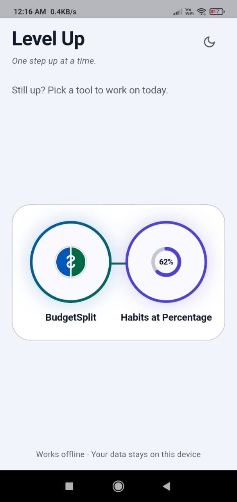
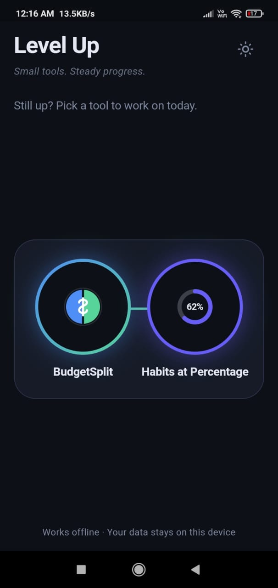
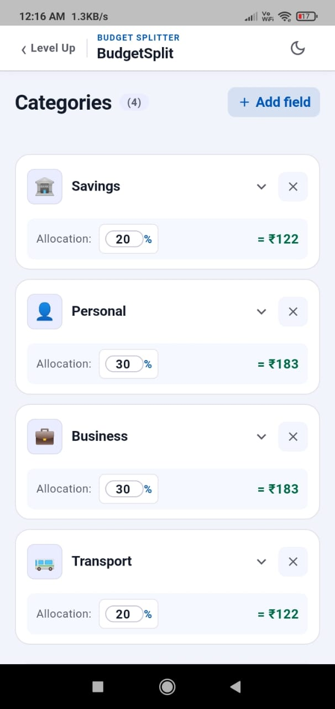
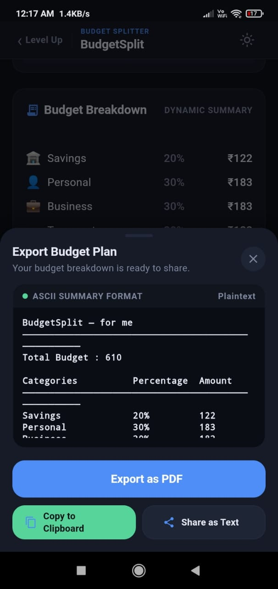
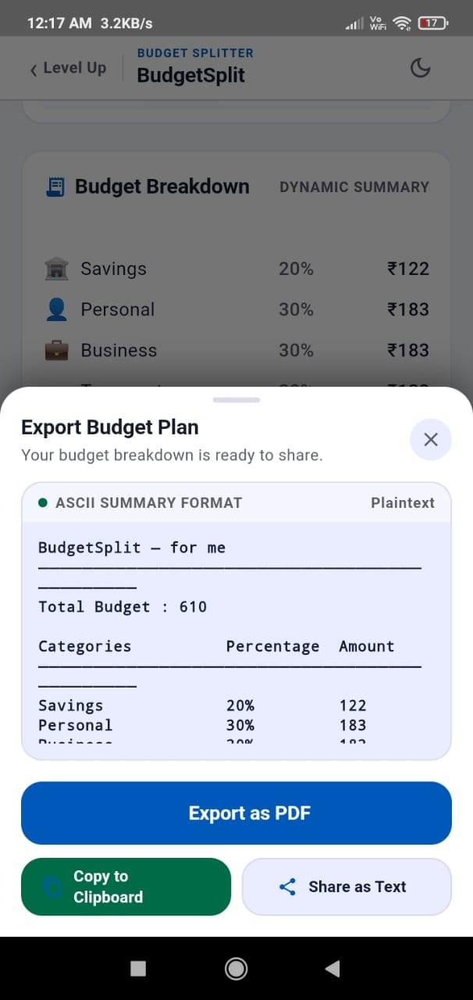
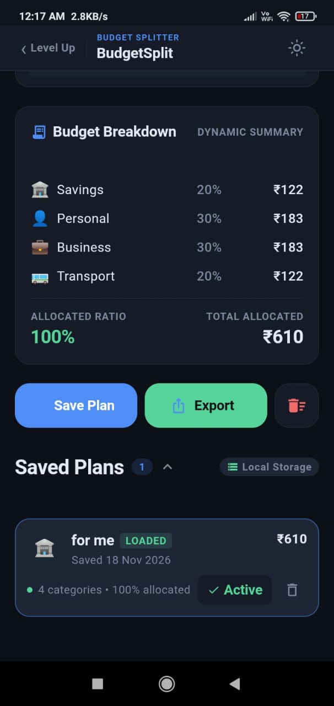
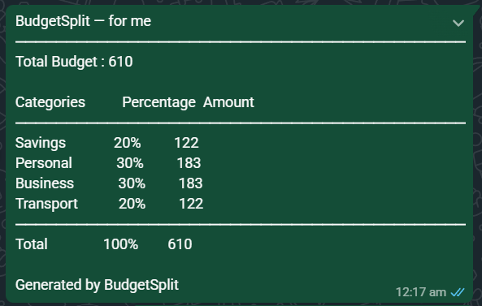
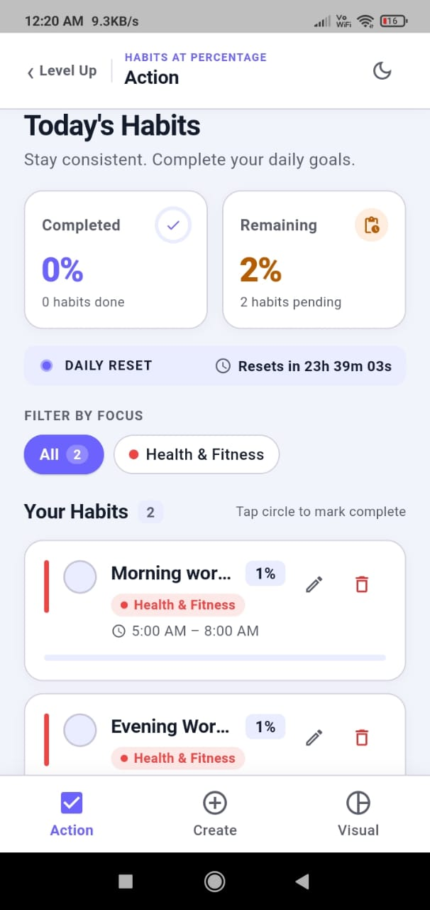
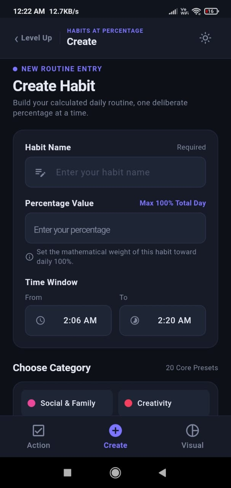

# Level Up

**Small tools. Steady progress.**

Level Up is a personal productivity toolkit designed as a mobile-first Android application. It provides a clean, offline-first hub that hosts focused utility modules — each built to help you manage one specific aspect of your daily routine.

> Works offline · Your data stays on this device

---

## ⬇️ Download & Install

[](https://github.com/HARIHAR1406/Level-Up-App/releases/latest/download/app-release.apk)

**[📱 Tap here to download the Level Up APK](https://github.com/HARIHAR1406/Level-Up-App/releases/latest/download/app-release.apk)**

> 1. Click the button above to download the APK
> 2. Open the downloaded file on your Android device
> 3. Tap **Install** (allow *Install from unknown sources* if prompted in settings)

---

## Screenshots

### Hub Screen
The main switchboard with interactive module launchers, rotating taglines, and contextual time-based greetings.

| Dark Mode | Light Mode |
|:---------:|:----------:|
|  |  |

### Module 1: BudgetSplit
A percentage-based budget planning tool with real-time calculations, saved plans, and multiple export options.

| Dark Mode | Light Mode |
|:---------:|:----------:|
|  |  |
|  |  |
|  |  |
|  |  |

#### Export Outputs
| PDF Report | Text Share |
|:----------:|:----------:|
|  |  |

### Module 2: Habits at Percentage
A daily habit tracker where each habit carries a percentage weight toward your 100% daily goal.

| Dark Mode | Light Mode |
|:---------:|:----------:|
|  |  |
|  |  |
|  |  |
|  |  |

---

## Features

### Hub (Home Screen)
- Interactive module launcher with animated circular buttons
- Connecting wire animation between modules
- Rotating motivational taglines
- Time-based contextual greetings (Good morning / afternoon / evening)
- Real-time telemetry badges showing module activity
- Dark / Light theme toggle
- Offline-first privacy notice

### Module 1: BudgetSplit
- **Budget Input** — Enter total budget with auto-calculation and rupee formatting
- **Plan Naming** — Name each budget plan for easy identification
- **Category Management** — Add preset or custom categories with emoji icons
- **Percentage Allocation** — Assign percentage splits with live amount calculations
- **Progress Tracking** — Visual progress bar with over-budget detection
- **Budget Breakdown** — Dynamic summary table with allocated ratios and amounts
- **Save & Load Plans** — Save multiple plans locally, load, and switch between them
- **Export as PDF** — Generate a styled, professional PDF breakdown report
- **Share as Text** — Share a formatted plaintext summary via any app
- **Copy to Clipboard** — Quick copy of the budget breakdown summary

### Module 2: Habits at Percentage
- **Percentage-Based Tracking** — Each habit carries a weight toward your daily 100% goal
- **Action Tab** — Today's habits with tap-to-complete circles, progress cards, and filter chips
- **Create Tab** — Add habits with name, percentage, time window, and focus category
- **Visual Tab** — Animated donut chart, completed/remaining stats, and category breakdown
- **20 Focus Categories** — Predefined categories with unique badge colors
- **Custom Categories** — Add personalized categories with custom colors
- **Daily Reset** — Automatic midnight reset with countdown timer display
- **Category Filtering** — Filter habits by focus category on the Action tab

---

## Tech Stack

| Component | Technology |
|-----------|-----------|
| **Framework** | Flutter (Dart) |
| **Platform** | Android |
| **State Management** | Provider (ChangeNotifier) |
| **Local Storage** | Hive (NoSQL) |
| **PDF Generation** | pdf package |
| **Typography** | Google Fonts (Roboto bundled offline) |
| **Sharing** | share_plus |
| **Date Formatting** | intl |
| **Architecture** | Feature-based modular architecture |

---

## Project Structure

```
Level-Up-App/
│
├── Source_Code/
│   └── level_up/                    # Flutter project root
│       ├── lib/
│       │   ├── main.dart            # App entry point (Hive init + providers)
│       │   ├── app.dart             # Root MaterialApp widget
│       │   │
│       │   ├── hub/                 # Hub (Home) Screen
│       │   │   ├── hub_screen.dart
│       │   │   ├── hub_controller.dart
│       │   │   └── widgets/         # Header, footer, module circles, wire
│       │   │
│       │   ├── budget_split/        # Module 1: BudgetSplit
│       │   │   ├── budget_split_screen.dart
│       │   │   ├── models/          # BudgetCategory, BudgetPlan
│       │   │   ├── providers/       # BudgetProvider (state management)
│       │   │   ├── services/        # BudgetStorage (Hive CRUD)
│       │   │   ├── utils/           # Calculator, formatter, PDF exporter
│       │   │   └── widgets/         # UI components (cards, inputs, sheets)
│       │   │
│       │   ├── habits/              # Module 2: Habits at Percentage
│       │   │   ├── habits_screen.dart
│       │   │   ├── models/          # Habit, HabitCategory, HabitState
│       │   │   ├── pages/           # Action, Create, Visual tabs
│       │   │   ├── providers/       # HabitsProvider (state management)
│       │   │   ├── services/        # Storage + daily reset service
│       │   │   ├── utils/           # Chart painter, calculator
│       │   │   └── widgets/         # Nav bar, cards, charts, timers
│       │   │
│       │   └── core/                # Shared foundation layer
│       │       ├── constants/       # Design tokens, storage keys
│       │       ├── models/          # Enums, module config
│       │       ├── theme/           # Colors, typography, theme config
│       │       ├── utils/           # Greeting, number formatting, taglines
│       │       └── widgets/         # Reusable UI components
│       │
│       ├── assets/
│       │   ├── images/              # App logos (SVG, PNG) and adaptive icons
│       │   └── fonts/               # Bundled Roboto fonts for offline PDF
│       │
│       ├── android/                 # Android platform configuration
│       ├── pubspec.yaml             # Dependencies and assets
│       └── pubspec.lock             # Locked dependency versions
│
├── Data/                                              # Project specifications, designs & logs
│   ├── 01_App_Logo/                                  # Brand identity & logo assets (SVG, PNG)
│   ├── 02_Framework_LevelUp_Hub/                     # Mainframe Hub framework specifications & UI designs
│   │   ├── UI_Designs_LevelUp_Hub/                   # Figma/Stitch design exports (HTML, CSS, previews)
│   │   └── LevelUp_Framework_Specification.docx      # Master hub architecture & feature document
│   ├── 03_Module_1_BudgetSplit/                      # BudgetSplit module specifications & UI designs
│   │   ├── UI_Designs_BudgetSplit/                   # 14 screen design folders (Dark/Light variants)
│   │   └── BudgetSplit_Module_1_Specification.docx   # BudgetSplit functional specifications
│   ├── 04_Module_2_Habits_at_Percentage/             # Habits at Percentage specifications & UI designs
│   │   ├── UI_Designs_Habits_at_Percentage/          # 4 screen design folders (Create, Action, Visual)
│   │   └── Habits_at_Percentage_Module_2_Specification.docx # Habits module documentation
│   └── 05_Issues_and_Modifications_Log.md            # Comprehensive issue & modification tracking log
│
├── Screenshots/                     # App screenshots (dark + light modes, 20 images)
│
├── .gitignore                       # Git ignore rules
└── README.md                        # This file
```

---

## Architecture

Level Up follows a **feature-based modular architecture**:

```
                    ┌─────────────────┐
                    │     main.dart    │
                    │  (Entry Point)   │
                    └────────┬────────┘
                             │
                    ┌────────▼────────┐
                    │     app.dart     │
                    │  (MaterialApp)   │
                    └────────┬────────┘
                             │
                    ┌────────▼────────┐
                    │   Hub Screen     │
                    │  (Switchboard)   │
                    └───┬─────────┬───┘
                        │         │
           ┌────────────▼─┐   ┌──▼────────────┐
           │  BudgetSplit  │   │   Habits at    │
           │   Module      │   │  Percentage    │
           └──────┬────────┘   └──────┬────────┘
                  │                    │
           ┌──────▼────────────────────▼──────┐
           │          Core Layer              │
           │  (Theme, Constants, Utilities)   │
           └──────────────┬───────────────────┘
                          │
                 ┌────────▼────────┐
                 │   Hive Storage   │
                 │  (Local NoSQL)   │
                 └─────────────────┘
```

Each module is **self-contained** with its own models, providers, services, utils, and widgets. The `core/` layer provides shared design system tokens and utilities.

---

## Data Storage

All application data is stored locally using **Hive** (a lightweight NoSQL database for Flutter).

| Hive Box | Purpose | Data |
|----------|---------|------|
| `lv_theme` | App settings | Theme mode, preferences |
| `bs_plans` | Budget plans | Saved plan names, categories, allocations |
| `hab_state` | Habit state | Daily habits, completion status, reset timestamp |

**Privacy by design:**
- All data stays on the device — no cloud sync, no server, no analytics
- Data is stored in Android internal storage (`getApplicationDocumentsDirectory()`)
- `android:allowBackup="false"` prevents cloud backup of app data
- All data is automatically deleted when the app is uninstalled

---

## Getting Started

### Prerequisites
- Flutter SDK (3.0+)
- Android SDK
- JDK 17

### Setup
```bash
# Clone the repository
git clone https://github.com/HARIHAR1406/Level-Up-App.git

# Navigate to the Flutter project
cd Level-Up-App/Source_Code/level_up

# Install dependencies
flutter pub get

# Run on a connected device or emulator
flutter run
```

### Build Release APK
```bash
cd Source_Code/level_up
flutter build apk --release
```
The APK will be generated at:
```
Source_Code/level_up/build/app/outputs/flutter-apk/app-release.apk
```

---

## Design System

The app uses a custom design system with:
- **4px spacing grid** for consistent layouts
- **Dark and Light themes** with smooth transitions
- **Module-specific accent colors** (Budget: Blue/Green, Habits: Indigo/Purple)
- **20 immutable category colors** for habit focus categories
- **Google Fonts (Roboto)** bundled for offline use
- **430px max viewport width** for consistent mobile presentation

---

## License

This project is for personal use and portfolio demonstration.

---

*Built with Flutter · Designed for Android · Fully Offline*

