<div align="center">

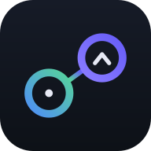

# Level Up

### **Small tools. Steady progress.**

A mobile-first, offline personal productivity toolkit for Android — built with Flutter.

[](https://github.com/HARIHAR1406/Level-Up-App/releases/latest/download/app-release.apk)
&nbsp;&nbsp;
[](https://flutter.dev)
&nbsp;&nbsp;
[](https://developer.android.com)

**[📱 Tap here to download the Level Up APK](https://github.com/HARIHAR1406/Level-Up-App/releases/latest/download/app-release.apk)**

> Works offline · Your data stays on your device · No cloud, no tracking

</div>

---

## 📸 Screenshots

### 🏠 Hub Screen (Main Switchboard)
The central dashboard with interactive module launchers, rotating motivational taglines, and contextual time-based greetings.

| Light Mode | Dark Mode |
|:----------:|:---------:|
|  |  |

---

### 💰 Module 1: BudgetSplit
A percentage-based budget planning tool with real-time calculations, category management, saved plans, and multiple export options.

| Light Mode | Dark Mode |
|:----------:|:---------:|
| 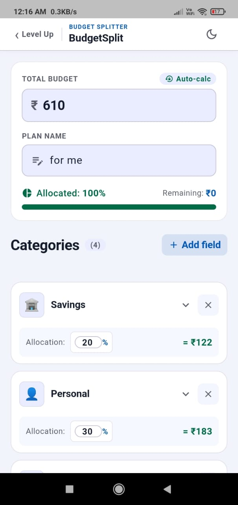 | 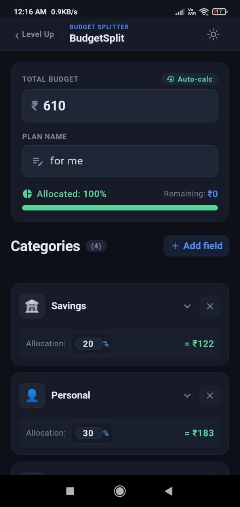 |
|  | 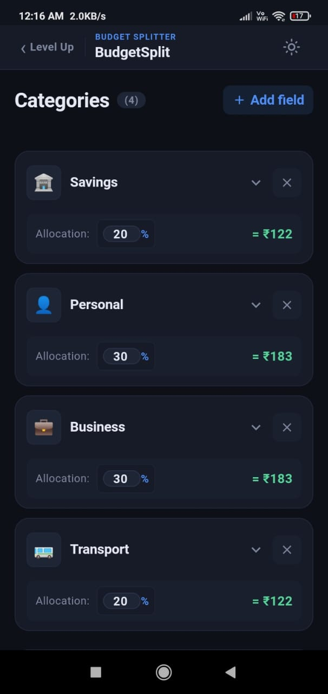 |
| 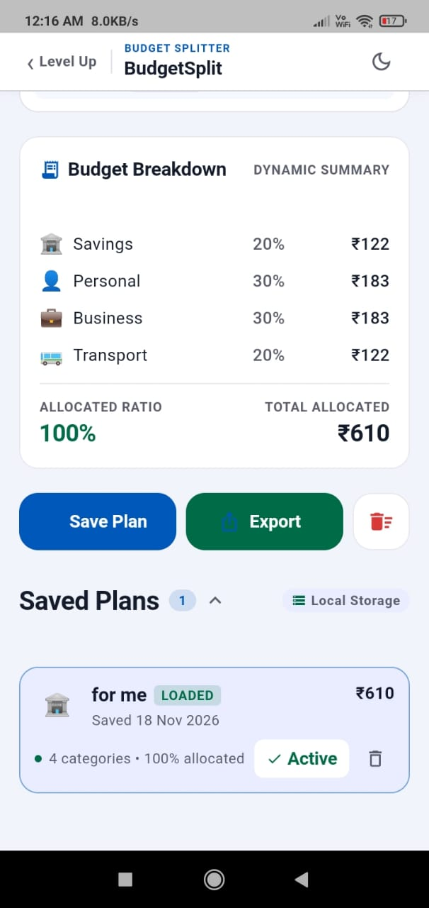 |  |
|  |  |

#### 📤 Export Outputs
| PDF Report | Text Share |
|:----------:|:----------:|
| 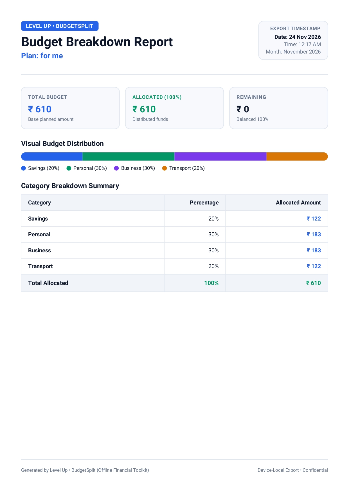 |  |

---

### 📊 Module 2: Habits at Percentage
A daily habit tracker where each habit carries a mathematical percentage weight toward your 100% daily goal.

| Light Mode | Dark Mode |
|:----------:|:---------:|
|  | 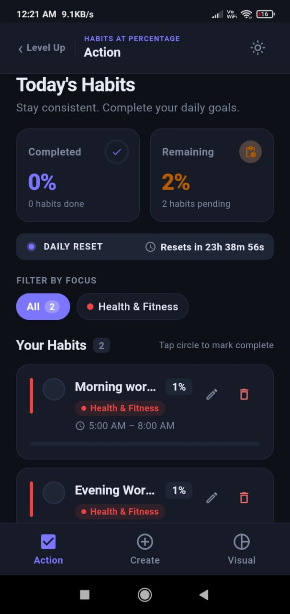 |
| 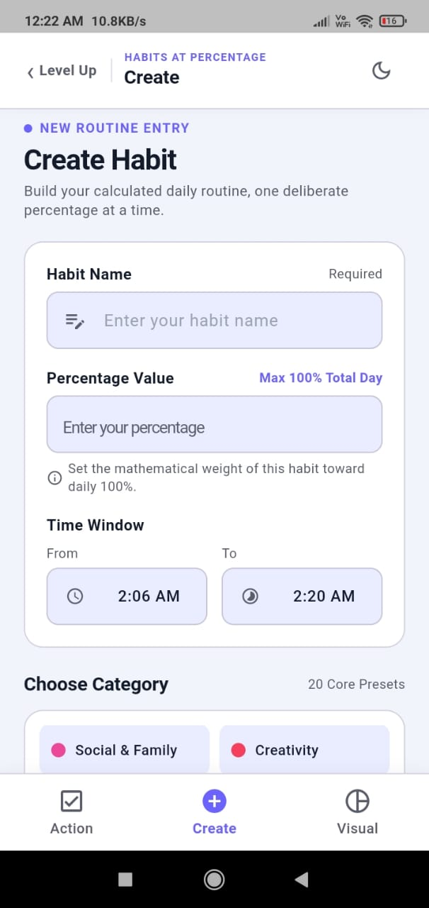 | 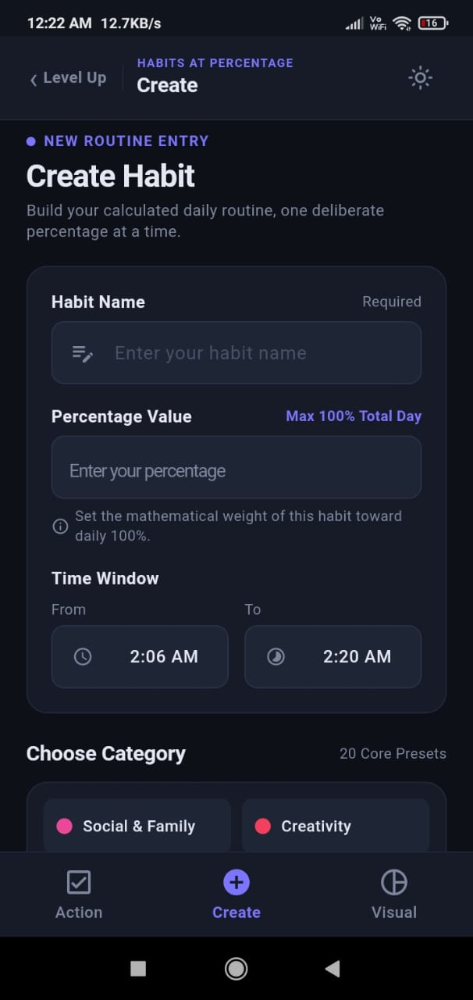 |
|  | 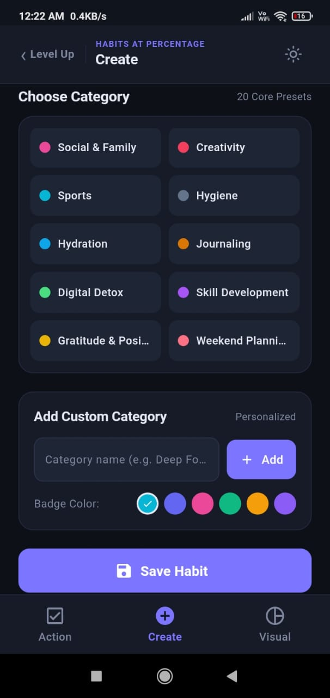 |
| 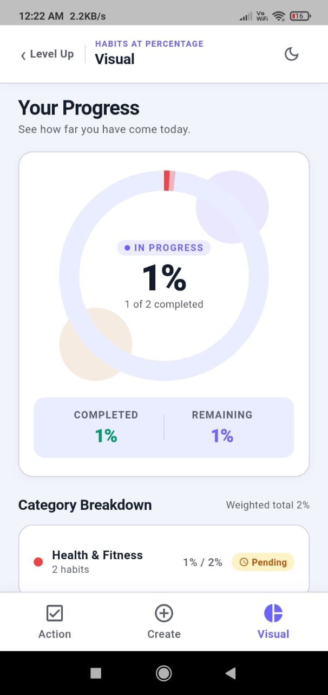 | 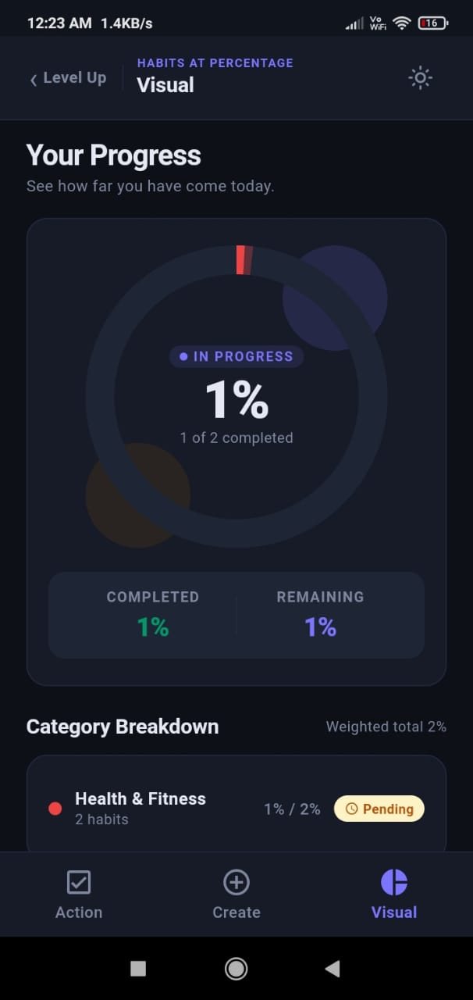 |

---

## ✨ Features

### 🏠 Hub (Home Screen)
- Interactive module launcher with animated circular buttons
- Connecting wire animation between modules
- Rotating motivational taglines
- Time-based contextual greetings (Good morning / afternoon / evening)
- Real-time telemetry badges showing module activity
- Dark / Light theme toggle
- Offline-first privacy notice

### 💰 Module 1: BudgetSplit
- **Budget Input** — Enter total budget with auto-calculation and rupee formatting
- **Plan Naming** — Name each budget plan for easy identification
- **Category Management** — Add preset or custom categories with emoji icons
- **Percentage Allocation** — Assign percentage splits with live amount calculations
- **Progress Tracking** — Visual progress bar with over-budget detection
- **Budget Breakdown** — Dynamic summary table with allocated ratios and amounts
- **Save & Load Plans** — Save multiple plans locally, load, and switch between them
- **Export as PDF** — Generate a styled, professional PDF breakdown report
- **Share as Text** — Share a formatted plaintext summary via any app
- **Copy to Clipboard** — Quick copy of the budget breakdown summary

### 📊 Module 2: Habits at Percentage
- **Percentage-Based Tracking** — Each habit carries a weight toward your daily 100% goal
- **Action Tab** — Today's habits with tap-to-complete circles, progress cards, and filter chips
- **Create Tab** — Add habits with name, percentage, time window, and focus category
- **Visual Tab** — Animated donut chart, completed/remaining stats, and category breakdown
- **20 Focus Categories** — Predefined categories with unique badge colors
- **Custom Categories** — Add personalized categories with custom colors
- **Daily Reset** — Automatic midnight reset with countdown timer display
- **Category Filtering** — Filter habits by focus category on the Action tab

---

## 🛠️ Tech Stack

| Component | Technology |
|:---|:---|
| Framework | Flutter (Dart) |
| Platform | Android |
| State Management | Provider (ChangeNotifier) |
| Local Database | Hive (NoSQL) |
| Document Export | pdf package |
| Sharing Service | share_plus |
| Typography | Google Fonts (Roboto bundled offline) |
| Date & Number Formatting | intl |
| Architecture | Feature-Based Modular Architecture |

---

## 🏗️ Architecture

Level Up is designed with a **feature-based modular architecture**. Each module operates independently with its own UI screens, reactive state providers, domain calculators, and local persistence layer, while communicating through a shared core foundation.

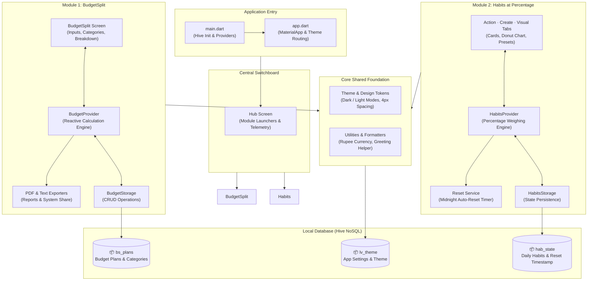

---

## 📂 Project Structure

```
Level-Up-App/
│
├── Source_Code/
│   └── level_up/                    # Flutter project root
│       ├── lib/
│       │   ├── main.dart            # App entry point (Hive init + providers)
│       │   ├── app.dart             # Root MaterialApp widget
│       │   │
│       │   ├── hub/                 # Hub (Home) Screen
│       │   │   ├── hub_screen.dart
│       │   │   ├── hub_controller.dart
│       │   │   └── widgets/         # Header, footer, module circles, wire
│       │   │
│       │   ├── budget_split/        # Module 1: BudgetSplit
│       │   │   ├── budget_split_screen.dart
│       │   │   ├── models/          # BudgetCategory, BudgetPlan
│       │   │   ├── providers/       # BudgetProvider (state management)
│       │   │   ├── services/        # BudgetStorage (Hive CRUD)
│       │   │   ├── utils/           # Calculator, formatter, PDF exporter
│       │   │   └── widgets/         # UI components (cards, inputs, sheets)
│       │   │
│       │   ├── habits/              # Module 2: Habits at Percentage
│       │   │   ├── habits_screen.dart
│       │   │   ├── models/          # Habit, HabitCategory, HabitState
│       │   │   ├── pages/           # Action, Create, Visual tabs
│       │   │   ├── providers/       # HabitsProvider (state management)
│       │   │   ├── services/        # Storage + daily reset service
│       │   │   ├── utils/           # Chart painter, calculator
│       │   │   └── widgets/         # Nav bar, cards, charts, timers
│       │   │
│       │   └── core/                # Shared foundation layer
│       │       ├── constants/       # Design tokens, storage keys
│       │       ├── models/          # Enums, module config
│       │       ├── theme/           # Colors, typography, theme config
│       │       ├── utils/           # Greeting, number formatting, taglines
│       │       └── widgets/         # Reusable UI components
│       │
│       ├── assets/
│       │   ├── images/              # App logos (SVG, PNG) and adaptive icons
│       │   └── fonts/               # Bundled Roboto fonts for offline PDF
│       │
│       ├── android/                 # Android platform configuration
│       ├── pubspec.yaml             # Dependencies and assets
│       └── pubspec.lock             # Locked dependency versions
│
├── Data/                                              # Project specifications, designs & logs
│   ├── 01_App_Logo/                                  # Brand identity & logo assets (SVG, PNG)
│   ├── 02_Framework_LevelUp_Hub/                     # Mainframe Hub framework specifications & UI designs
│   │   ├── UI_Designs_LevelUp_Hub/                   # Figma/Stitch design exports (HTML, CSS, previews)
│   │   └── LevelUp_Framework_Specification.docx      # Master hub architecture & feature document
│   ├── 03_Module_1_BudgetSplit/                      # BudgetSplit module specifications & UI designs
│   │   ├── UI_Designs_BudgetSplit/                   # 14 screen design folders (Dark/Light variants)
│   │   └── BudgetSplit_Module_1_Specification.docx   # BudgetSplit functional specifications
│   ├── 04_Module_2_Habits_at_Percentage/             # Habits at Percentage specifications & UI designs
│   │   ├── UI_Designs_Habits_at_Percentage/          # 4 screen design folders (Create, Action, Visual)
│   │   └── Habits_at_Percentage_Module_2_Specification.docx # Habits module documentation
│   └── 05_Issues_and_Modifications_Log.md            # Comprehensive issue & modification tracking log
│
├── Screenshots/                     # App screenshots (dark + light modes, 20 images)
│
├── .gitignore                       # Git ignore rules
└── README.md                        # This file
```

---

## 💾 Data Storage

All application data is stored locally using **Hive** (a lightweight NoSQL database for Flutter).

| Hive Box | Purpose | Stored Data |
|:---|:---|:---|
| `lv_theme` | App Settings | Theme mode (Dark/Light), user preferences |
| `bs_plans` | Budget Plans | Saved plan names, categories, allocations, percentage splits |
| `hab_state` | Habit Tracking | Daily habits, completion status, category weights, reset timestamps |

**🔒 Privacy by design:**
- All data stays on the device — no cloud sync, no server, no analytics
- Data is stored in Android internal storage (`getApplicationDocumentsDirectory()`)
- `android:allowBackup="false"` prevents cloud backup of app data
- All data is automatically deleted when the app is uninstalled

---

## 🚀 Getting Started

### Prerequisites
- Flutter SDK (3.0+)
- Android SDK
- JDK 17

### Setup
```bash
# Clone the repository
git clone https://github.com/HARIHAR1406/Level-Up-App.git

# Navigate to the Flutter project
cd Level-Up-App/Source_Code/level_up

# Install dependencies
flutter pub get

# Run on a connected device or emulator
flutter run
```

### Build Release APK
```bash
cd Source_Code/level_up
flutter build apk --release
```
The APK will be generated at:
```
Source_Code/level_up/build/app/outputs/flutter-apk/app-release.apk
```

---

## 🎨 Design System

The app uses a custom design system with:
- **4px spacing grid** for consistent layouts
- **Dark and Light themes** with smooth transitions
- **Module-specific accent colors** (Budget: Blue/Green, Habits: Indigo/Purple)
- **20 immutable category colors** for habit focus categories
- **Google Fonts (Roboto)** bundled for offline use
- **430px max viewport width** for consistent mobile presentation

---

## 🔮 Future Vision & Enhancements

Level Up is a project shaped from my own thought process, product ideas, and real-world daily productivity needs. I brought this vision to life as a fully functional, offline-first personal toolkit.

In upcoming releases, I look forward to enhancing Level Up further by adding more focused modules, refining the UI interactions, and expanding its capabilities.

If you find this project interesting, have feedback, or would like to collaborate and discuss ideas, feel free to reach out via Email or connect on LinkedIn!

---

## 👨‍💻 Developer

**HARIHAR R**

- **Email:** [harihar.r1406@gmail.com](mailto:harihar.r1406@gmail.com)
- **LinkedIn:** [linkedin.com/in/harihar-r](https://www.linkedin.com/in/harihar-r)
- **GitHub:** [github.com/HARIHAR1406](https://github.com/HARIHAR1406)

---

*Built with Flutter · Designed for Android · Fully Offline*
